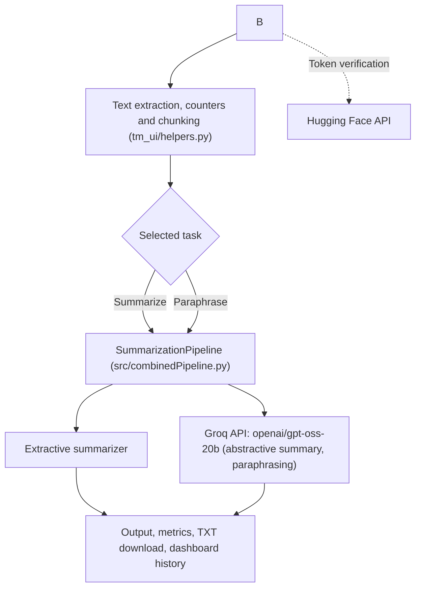

<div align="center">

# TextMorph

### AI-Powered Text Summarization & Paraphrasing System

[](https://textmorph-jeet.streamlit.app/)


*Summarize and paraphrase text, documents and spoken input through a clean, responsive web interface.*

[Live Demo](https://text-summarization-and-paraphrasing.streamlit.app/) · [Source Code](https://github.com/JeetMourya/AI-TEXT-MORPH-PROJECT) · [Report an Issue](https://github.com/JeetMourya/AI-TEXT-MORPH-PROJECT/issues)

</div>

---

## 📖 Project Overview

**TextMorph** is a Streamlit web application developed as a B.Tech 5th-semester Cornerstone Project. It condenses long text into summaries and rewrites text in different words while keeping the original meaning.

Input can be typed or pasted text, an uploaded PDF, DOCX or TXT file, . Each result comes with word, character and sentence counts, compression figures and processing time, all calculated from the actual output.

Two summarization approaches are available:

- **Extractive**: selects the most important sentences from the original text.
- **Abstractive**: generates a new summary with an AI language model.

## 🌐 Live Demo

**https://textmorph-jeet.streamlit.app/**

The demo depends on external AI APIs. If it is slow or returns an error, open **API / Service Status** in the sidebar for guidance.

## 📸 Screenshots

## 📸 Screenshots


## ✨ Key Features

| Area | What it does |
|------|--------------|
| **Summarization** | Extractive and abstractive modes with Short, Medium and Long length options |
| **Paraphrasing** | Rewrites text using an AI model and returns multiple rewritten versions |
| **Document upload** | Extracts text from PDF, DOCX and TXT files, then lets you review it before processing |
| **Long-text handling** | Optionally splits long text into sections, processes each, and combines the results |
| **Dashboard** | Session statistics and a history of recent processing runs |
| **API / Service Status** | Separate checks for key presence, token verification and the last real request |
| **Export** | Copy the output or download it as a `.txt` file |
| **Interface** | Dark and light themes, sidebar navigation, responsive layout |
| **Text analysis** | Word, character and sentence counts, compression or length change, and processing time |

## 🧠 AI Architecture and Backend

The Streamlit front end (`app.py` and `tm_ui/`) sends text to a single backend class, `SummarizationPipeline`, defined in `src/combinedPipeline.py`.

| Task | Backend |
|------|---------|
| Extractive summarization | The project's extractive summarizer in `src/` |
| Abstractive summarization | **Groq API** with the **`openai/gpt-oss-20b`** model |
| Paraphrasing | **Groq API** with the **`openai/gpt-oss-20b`** model |
| API token check | **Hugging Face API** (token verification on the status page) |



> Text sent for abstractive summarization or paraphrasing is processed by the Groq API, so an internet connection and a valid API key are required for those features.

## 🛠️ Technologies Used

| Technology | Purpose |
|------------|---------|
| Python | Core language |
| Streamlit | Web application framework |
| Groq API | Abstractive summarization and paraphrasing (`openai/gpt-oss-20b`) |
| Hugging Face API | API token verification and connectivity check |
| Requests | HTTP calls for the status check |
| python-dotenv | Loading API keys from a local `.env` file |
| PyPDF | Text extraction from PDF files |
| python-docx | Text extraction from DOCX files |
| NLTK, Scikit-learn, NumPy | Text processing for the extractive summarizer |

## 🔄 Application Workflow

1. Provide text by typing or pasting, uploading a document.
2. Review and edit the text. The app shows live word, character and sentence counts.
3. Choose an action: summarize (method and length) or paraphrase.
4. For long documents, optionally enable section-based processing.
5. The request goes through `SummarizationPipeline` to the extractive summarizer or the Groq model.
6. The result appears with metrics. Copy it or download it as `.txt`.
7. The run is added to the Dashboard history and the API status is updated.

## 📁 Project Folder Structure

```
AI-TEXT-MORPH-PROJECT/
├── .devcontainer/        # Dev container configuration
├── assets/               # Screenshots
├── components/
├── configure/            # Configuration files
├── docs/                 # Documentation
├── src/
│   ├── combinedPipeline.py   # SummarizationPipeline (backend entry point)
│   └── ...                   # Summarizer and paraphraser modules
├── tm_ui/
│   ├── __init__.py
│   ├── api_status.py     # API status checks and error classification
│   ├── helpers.py        # Counters, chunking, document extraction, HTML helpers
│   └── theme.py          # Theme and styling
├── .gitignore
├── app.py                # Streamlit application
├── requirements.txt
└── README.md
```

## 🚀 Installation and Local Setup

**Prerequisites:** Python 3.10 or newer (recommended), a Groq API key and a Hugging Face token.

```bash
# 1. Clone the repository
git clone https://github.com/JeetMourya/AI-TEXT-MORPH-PROJECT.git
cd AI-TEXT-MORPH-PROJECT

# 2. Create and activate a virtual environment
python -m venv venv
venv\Scripts\activate          # Windows
# source venv/bin/activate     # macOS / Linux

# 3. Install dependencies
pip install -r requirements.txt

# 4. Create src/.env (see the next section), then run
streamlit run app.py
```

Open `http://localhost:8501` in your browser.

## 🔑 Environment Variables and API Configuration

The app loads keys from **`src/.env`**. Create this file locally:

```env
HF_API_KEY=your_huggingface_token
GROQ_API_KEY=your_groq_api_key
```

| Variable | Purpose | Get a key |
|----------|---------|-----------|
| `HF_API_KEY` | Hugging Face token (required to start the app) | https://huggingface.co/settings/tokens |
| `GROQ_API_KEY` | Groq API key for abstractive summarization and paraphrasing | https://console.groq.com/keys |

> ⚠️ **Never commit `.env` to GitHub.** Confirm that `.env` is listed in `.gitignore`. If a real key was ever pushed, revoke it and create a new one.

## ☁️ Streamlit Cloud Deployment

1. Push the repository to GitHub without any `.env` file.
2. On [Streamlit Community Cloud](https://share.streamlit.io), create a new app from this repository.
3. Set the branch to `main` and the main file path to `app.py`.
4. Open **Advanced settings → Secrets** and add:

```toml
HF_API_KEY = "your_huggingface_token"
GROQ_API_KEY = "your_groq_api_key"
```

5. Deploy. The app reads these values from Streamlit secrets when no `.env` file is present. The Hugging Face token can also be stored under the name `HF_TOKEN`.

## 🧭 How to Use the Application

1. **Dashboard:** open a tool and review session statistics and recent activity.
2. **Text Summarization:** paste text, choose *Extractive* or *Abstractive*, choose a length, and click **Generate summary**.
3. **Text Paraphrasing:** paste text and click **Paraphrase text**.
4. **Document Processing:** upload a PDF, DOCX or TXT file, check the extracted text, choose *Summarize* or *Paraphrase*, and optionally enable section-based processing for long documents.
6. **Output:** use **Copy output** or **Download .txt**, or **Clear output** to reset.

## 📡 API / Service Status

The **API / Service Status** page keeps three checks separate:

| Check | Meaning |
|-------|---------|
| **API key configured** | A key value exists. It says nothing about validity. |
| **Connection verified** | Hugging Face accepted the token when **Verify connection** was clicked. |
| **Last real request** | Whether the most recent summarize or paraphrase request succeeded. |

Failures are classified as invalid key, rate limit reached, network error or API unavailable, each with retry guidance. Token verification does not prove that the Groq model is reachable. Only a successful real request does.

## ⚠️ Limitations and Future Improvements

**Current limitations**

- Abstractive summarization and paraphrasing need internet access and depend on external API availability and rate limits.
- PDF extraction works only for text-based PDFs. Scanned documents need OCR, which is not included. Legacy `.doc` files are not supported.
- Dashboard history is stored in the browser session only and resets on refresh.
- The status page verifies the Hugging Face token. The Groq key is checked only through real requests.

**Possible improvements**

- OCR for scanned documents.
- Paraphrasing style presets (for example academic or concise).
- Persistent history and batch processing.
- Multi-language summarization.
- Automated tests and CI.

## 🔒 Security Notes

- API keys are read from `src/.env` or Streamlit secrets and are never displayed in the interface.
- Keep `.env` out of version control and rotate any key that has been exposed.
- Text submitted for abstractive summarization or paraphrasing is sent to the Groq API. Do not submit confidential or personal documents unless this is acceptable.
- Uploaded documents are processed in the app session for text extraction.

## 👥 Contributors / Author

Developed by **Jeet Mourya** ([@JeetMourya](https://github.com/JeetMourya)) and **Karan** as a B.Tech 5th-semester Cornerstone Project.

---

<div align="center">

**TextMorph – AI-Powered Text Summarization & Paraphrasing System**

</div>
